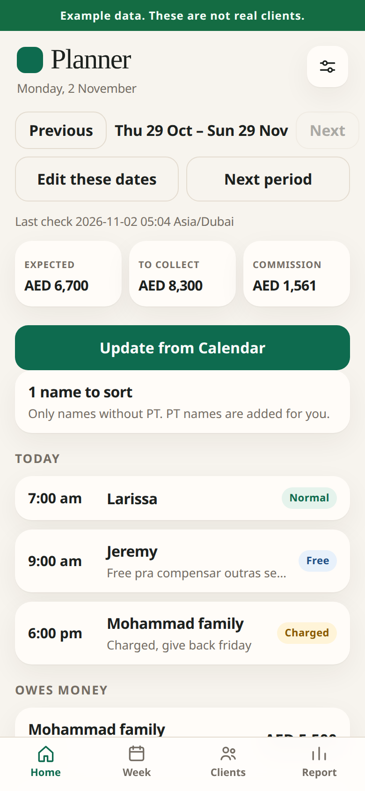
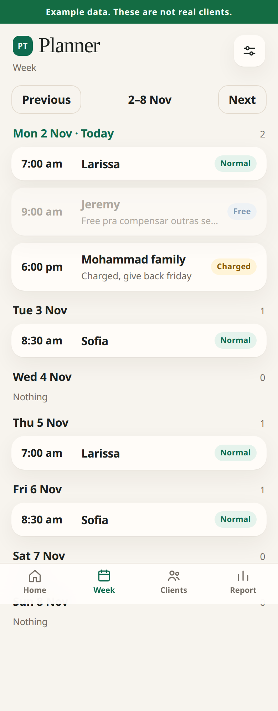
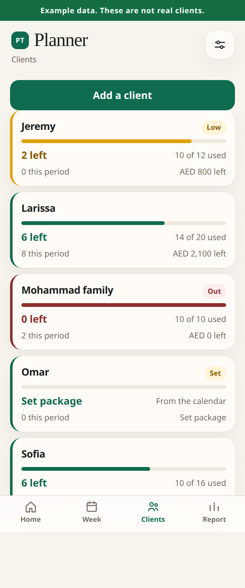
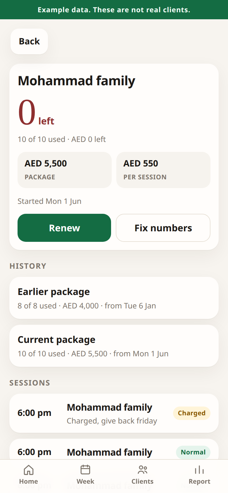
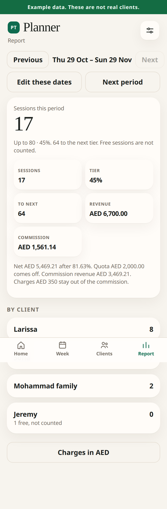
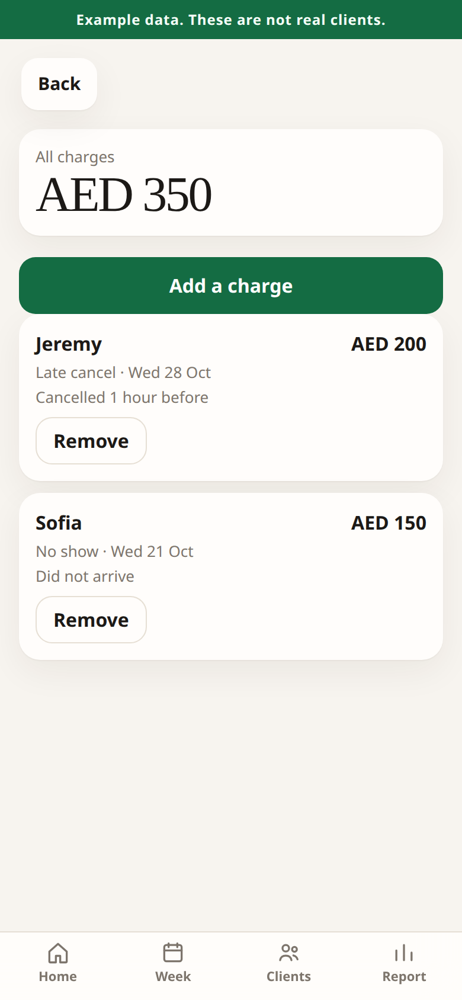
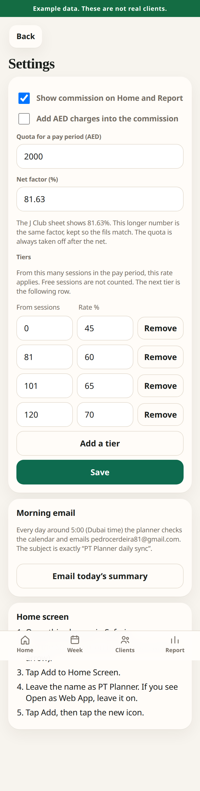

# PT Planner

Pedro’s sessions come from his Google Calendar. Only a title that **ends in PT**, such as `Omar PT` or `Jeremy Pt`, becomes a client. Shifts and personal events are left out. A PT title that contains the word **free**, such as `Omar free PT`, still shows on the day, marked Free, and is left out of every count. Clients, packages, and pay periods stay in a private Google Sheet on his account. Nothing about a client is stored on this public website.

The old page is still at the same address. This planner is a separate link he puts on his iPhone.

The pictures further down use made-up example clients. The green bar says **Example data**.

His “month” is a J Club pay period with its own start and end, such as 30 Sep to 28 Oct, then 29 Oct to 29 Nov. The app never uses a calendar month.

## Set it up once, on the iPhone

Use **Safari**. Sign in as **pedrocerdeira81@gmail.com** whenever Google asks. Do not use the Google Sheets app.

There is one file to paste: [Code.gs](apps-script/Code.gs)

If a full address is easier, after this page is on the main site use:

https://github.com/pedrocerdeira81-coder/Pt-planner/blob/main/apps-script/Code.gs

### Make the private sheet

1. Open Safari.
2. Tap the address bar.
3. Type `sheets.new` and tap Go.
4. If Google asks you to sign in, tap **pedrocerdeira81@gmail.com**.
5. Tap the title **Untitled spreadsheet**.
6. Type `PT Planner` and tap the tick or OK.

### Show the full menu

7. Tap **AA** on the left of the address bar.
8. Tap **Request Desktop Website**.
9. If you do not see **Extensions**, pinch the page smaller until that word appears.

### Open the script and paste it

10. Tap **Extensions**.
11. Tap **Apps Script**.
12. If Google asks you to sign in again, choose **pedrocerdeira81@gmail.com**.
13. Tap **Untitled project** at the top left, type `PT Planner`, and tap **Rename**.
14. Open a new tab and tap [Code.gs](apps-script/Code.gs).
15. Tap **Raw**.
16. Tap and hold the code, tap **Select All**, then tap **Copy**. The file is long. If only a short piece highlights, tap the page once and try Select All again.
17. Go back to the Apps Script tab.
18. Tap inside the code box, tap and hold, tap **Select All**, then tap **Paste**. The first lines should mention PT Planner, not `function myFunction`.
19. Tap the save icon at the top and wait until it finishes.

### Turn it into a private app

20. Tap **Deploy**.
21. Tap **New deployment**.
22. Next to **Select type**, tap the gear.
23. Tap **Web app**.
24. In the description box, type `PT Planner`.
25. **Execute as** must say **Me** and show pedrocerdeira81@gmail.com. If it does not, tap it and choose **Me**.
26. Tap **Who has access** and choose **Only myself**. Do not choose Anyone.
27. Tap **Deploy**.
28. Tap **Authorize access**.
29. Tap **pedrocerdeira81@gmail.com**.
30. Google says the app isn’t verified. Tap **Advanced**.
31. Tap **Go to PT Planner (unsafe)**.
32. Leave every switch on.
33. Tap **Allow**.
34. Tap **Copy** on the link that ends in `/exec`.
35. Paste that link into Notes, then tap **Done**.

### Put it on the home screen

36. Tap the address bar, paste the link, and tap Go.
37. Wait while it reads the calendar. If Google asks again, tap **Advanced**, then **Go to PT Planner (unsafe)**, then **Allow**.
38. Tap **Share** at the bottom of Safari. It is a square with an arrow pointing up.
39. Tap **Add to Home Screen**.
40. Leave the name as **PT Planner**. If you see **Open as Web App**, leave it on.
41. Tap **Add**.
42. Tap the new **PT Planner** icon.

The 5:00 check turns on when that page opens. You do not set an alarm.

### Set the pay period

43. On Home, under the date, tap the start date and the end date for the current J Club period.
44. Tap **Save period**.
45. Sessions, charges, earnings, and commission all use those two dates.
46. When the gym starts the next period, tap **Next period**, enter the new start and end, and tap **Save**. That period becomes the one you are looking at.
47. Tap **Previous** to see an older period. Tap **Edit these dates** to change either date. The numbers update as soon as you tap **Save**.

### Fill in each package

A calendar title that ends in PT creates the client. The package starts today, so older sessions do not use it up.

48. Tap a client that says **Set package**, or tap **Clients**, then the person.
49. Tap **Fix numbers** (it may say that on the client page).
50. Enter the package size, how many are left, the package value in AED, and the start date.
51. Tap **Save**.

Anything that does not end in PT, such as a shift or `O pai morreu`, is skipped. It is not listed, and it is not in the morning email.

### Check the morning email

52. Tap the sliders icon.
53. Tap **Email today’s summary**.
54. Open Gmail and find the subject `PT Planner daily sync`.

After that, leave it. Around 5:00 Dubai time the same email arrives even if the phone stays closed. Google may start it up to about 15 minutes either side of 5:00.

## Day to day

- **Home** shows the pay period, sessions in it, the current tier, how many sessions until the next tier, revenue, commission, today’s sessions, and who is low or out. A free session is faded and is not in the number beside Today.
- **Week** opens on this week. **Previous day** and **Next day** move one day. The date box jumps to a day. **Today** comes back. **Previous week** and **Next week** move seven days. A day only lists sessions already saved from the calendar. On a client, each session shows its date as well as the time.
- Tap a session to mark it **Normal**, **Free**, or **Charged**. Free does not use a session. Normal and charged do, once the session has finished in Dubai time and the date is on or after the package start. A later booking stays on the list and is not used yet. If the calendar title contains the word free, the next check marks it Free again.
- **Renew** keeps the old package in the history. The new one must start after the old one.
- **Report** uses the same sessions, tier, revenue, and commission as Home. **Charges** uses the pay period you are viewing.
- The quota in the gear is for one pay period. It starts at 7,758 AED and is always taken off. The net factor starts at the precise September 2026 figure (the form prints it as 81.63%). Up to 80 sessions is 45%, 81–100 is 60%, 101–119 is 65%, and 120 or more is 70%. Those rows can be edited. Charges stay out of the commission until you switch that on.
- **Update from Calendar** checks again before 5:00.

## Good to know

- The planner needs the internet.
- Client names live only in the Google Sheet called PT Planner. Do not delete its tabs.
- If the home-screen icon later asks you to sign in, open the saved link in Safari, then open the icon again.
- If you change your Google password, open the planner and tap **Allow** if Google asks.

## What the screens look like

These are example clients, not Pedro’s. The sample period is 29 Oct to 29 Nov.

## For the assistant

Read `PT Planner daily sync` in pedrocerdeira81@gmail.com. The layout, including the `Period:` line, is in [docs/daily-email.md](docs/daily-email.md).

Pedro has to paste the one file, tap Deploy, and tap Allow. The script has to run as his Google account. You can point at the buttons. You cannot finish those taps without him.
