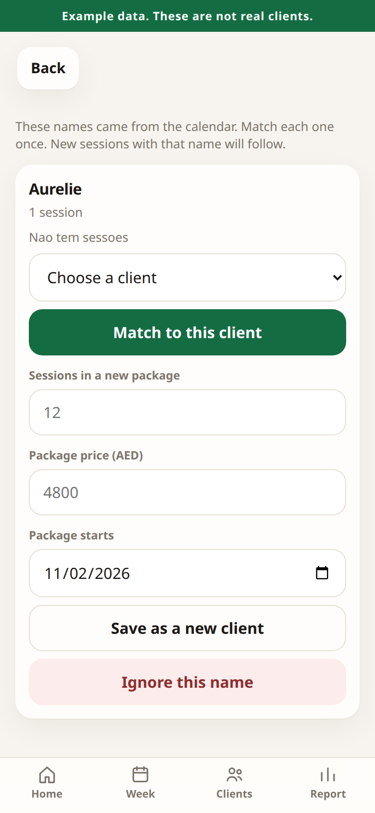

# PT Planner

Pedro’s sessions come from his Google Calendar. Clients, packages, and charges stay in a private Google Sheet on his own account. Nothing about a client is stored in this public website.

The old page is still at the same address and still keeps whatever is saved in that browser. This new planner is a separate link he puts on his iPhone home screen.

The pictures further down use made-up example clients. The green bar on each one says **Example data**.

## Set it up once, on the iPhone

Use **Safari**. Sign in as **pedrocerdeira81@gmail.com** whenever Google asks. Do not use the Google Sheets app. Its menus hide the script.

You will paste two files. Tap the names here and they open:

- [Code.gs](apps-script/Code.gs)
- [Index.html](apps-script/Index.html)

If a full address is easier to type, use these after this page is on the main site:

- https://github.com/pedrocerdeira81-coder/Pt-planner/blob/main/apps-script/Code.gs
- https://github.com/pedrocerdeira81-coder/Pt-planner/blob/main/apps-script/Index.html

### Make the private sheet

1. Open Safari.
2. Tap the address bar at the top.
3. Type `sheets.new` and tap Go.
4. If Google asks you to sign in, tap **pedrocerdeira81@gmail.com** and finish signing in.
5. Tap the title **Untitled spreadsheet** at the top of the page.
6. Delete that title and type `PT Planner`.
7. Tap the tick, or tap OK.

### Show the full menu

8. Tap **AA** on the left side of the address bar.
9. Tap **Request Desktop Website**.
10. If you do not see a row of words that includes **Extensions**, pinch the page smaller with two fingers until you do.

### Open the script

11. Tap **Extensions**.
12. Tap **Apps Script**.
13. A new tab opens. If Google asks you to sign in again, choose **pedrocerdeira81@gmail.com**.
14. Tap the name **Untitled project** at the top left.
15. Type `PT Planner` and tap **Rename**.

### Paste the first file

16. Open a new tab.
17. Tap [Code.gs](apps-script/Code.gs). If that does not open, paste `https://github.com/pedrocerdeira81-coder/Pt-planner/blob/main/apps-script/Code.gs` into the address bar and tap Go.
18. Tap **Raw**. The page should be only code, with no buttons around it.
19. Tap and hold on the code, then tap **Select All**, then tap **Copy**.
20. Go back to the Apps Script tab.
21. Tap inside the code box. Tap and hold, tap **Select All**, then tap **Paste**. The box should no longer start with `function myFunction`. The first lines should mention PT Planner.
22. If the paste looks like only a few lines, the copy was cut off. Repeat steps 18 to 21.
23. Tap the save icon at the top. It looks like a floppy disk. Wait until it finishes.

### Paste the screen

24. In the Apps Script tab, next to **Files**, tap the **+** button.
25. Tap **HTML**.
26. Delete the suggested name and type `Index`. Do not type `.html`. Google adds that itself.
27. Tap the tick.
28. The new file has a few sample lines. Tap and hold in that file, tap **Select All**, then delete them so the file is empty.
29. Open a new tab and tap [Index.html](apps-script/Index.html), or go to `https://github.com/pedrocerdeira81-coder/Pt-planner/blob/main/apps-script/Index.html`.
30. Tap **Raw**.
31. Tap and hold, tap **Select All**, then tap **Copy**. This file is long. If Select All only highlights a short piece, tap the page once and try Select All again.
32. Go back to the **Index.html** file in Apps Script.
33. Tap the empty file, then tap **Paste**.
34. Tap the save icon again and wait until it finishes.

### Turn it into a private app

35. Tap **Deploy** at the top right.
36. Tap **New deployment**.
37. Next to **Select type**, tap the gear icon.
38. Tap **Web app**.
39. Tap the description box and type `PT Planner`.
40. **Execute as** must say **Me** and show pedrocerdeira81@gmail.com. If it does not, tap it and choose **Me**.
41. Tap **Who has access** and choose **Only myself**. Do not choose Anyone. Anyone with the link could then see client names.
42. Tap **Deploy**.
43. Tap **Authorize access**.
44. Tap **pedrocerdeira81@gmail.com**.
45. Google says this app isn’t verified. That is expected, because it is your own script. Tap **Advanced**.
46. Tap **Go to PT Planner (unsafe)**.
47. If you see switches for Calendar, Sheets, or email, leave every switch on.
48. Tap **Allow**.
49. A box shows a link that starts with `https://script.google.com/` and ends with `/exec`. Tap **Copy**.
50. Paste that link into the Notes app so you still have it if the home-screen icon is deleted. Then go back and tap **Done**.

### Open it and add the home-screen icon

51. Tap the address bar, paste the link, and tap Go.
52. Wait while it reads the calendar. The first time can take a minute. If Google asks you to allow something else, tap **Advanced**, then **Go to PT Planner (unsafe)**, then **Allow**.
53. Tap the **Share** button at the bottom of Safari. It is a square with an arrow pointing up.
54. Scroll the list and tap **Add to Home Screen**.
55. The name should say **PT Planner**. If it does not, type `PT Planner`.
56. If you see **Open as Web App**, leave it switched on.
57. Tap **Add**.
58. Swipe to the home screen and tap the new **PT Planner** icon.

The 5:00 check is turned on by that first open. You do not set an alarm.

### Sort calendar names

59. If the planner says a name needs sorting, tap that row.
60. If that person is already a client, choose them in the list and tap **Match to this client**.
61. If they are new, type the number of sessions, the price in AED, and the start date, then tap **Save as a new client**.
62. If the event is not a client, tap **Ignore this name**. Lunch, birthdays, and similar events can be ignored. **Resumo** and **New month** are already skipped.

Titles like `Larissa PT`, `Jeremy Pt`, and `Mohammad family PT` are read as client names. A title with no PT, such as `Aurelie`, is shown once so you can match it or ignore it.

### Add a client by hand

63. Tap **Clients** at the bottom.
64. Tap **Add a client**.
65. Type the name the way it appears on the calendar, without the word PT.
66. Type how many sessions are in the current package, the price in AED, and the day the package started.
67. Tap **Add client**.

### Bring over the old list, if Safari still has it

68. In the planner, tap the sliders icon at the top right.
69. Tap **Bring over old clients**.
70. Safari opens a page with the clients saved by the old planner.
71. If it says no clients were found, they only exist inside the old home-screen icon and cannot be copied. Use **Add a client** instead, and skip to the next section.
72. If the names look right, tap **Add these clients to PT Planner**.
73. The planner opens again and says how many clients it added. Old sessions are not copied. The calendar is what fills sessions, so they are not counted twice.

### Check that the morning email arrives

74. Tap the sliders icon.
75. Tap **Email today’s summary**.
76. Open the Gmail app.
77. Open the message whose subject is exactly `PT Planner daily sync`.

After this, leave it. Around 5:00 Dubai time each day, the same email arrives even if the iPhone stays closed. It can be a little before or after 5:00. Google does not start it at the exact second. It is usually within about 15 minutes.

## Day to day

- **Home** is today, plus anyone who is low (1 or 2 left) or out.
- **Week** is the sessions for the week.
- Tap a session to mark it **Normal**, **Free**, or **Charged**. Free does not use a package session. Normal and charged do. A note on the calendar, such as “Charged” or “Free pra compensar”, is shown on the session and suggested the first time.
- **Clients** shows what is left. **Renew** keeps the old package in the history. The new package must start after the old one.
- **Report** is the month, with the commission estimate. The gear can hide that estimate. The usual quota starts at 7,758 AED and the net factor at 81.63%. Charges in AED are left out of the commission until you switch that on.
- **Update from Calendar** checks again without waiting for 5:00.

## Good to know

- The planner needs the internet.
- Client names live in the Google Sheet called PT Planner. Do not delete the tabs in that sheet. Do not put client names into the files on this website.
- The public GitHub page cannot see the sheet.
- If the home-screen icon later asks you to sign in, open the saved link in Safari while you are signed in, then open the icon again.
- If you change your Google password, open the planner and tap **Allow** if Google asks.

## What the screens look like

These are example clients, not Pedro’s.

## For the assistant

The morning summary is the email above. The exact layout is in [docs/daily-email.md](docs/daily-email.md). Read it from pedrocerdeira81@gmail.com. There is no sheet access and no public data link.

Pedro has to be the one who pastes the files, taps Deploy, and taps Allow, because the script has to run as his Google account. Someone with him can point at the buttons. They cannot finish it from another computer without his sign-in.
